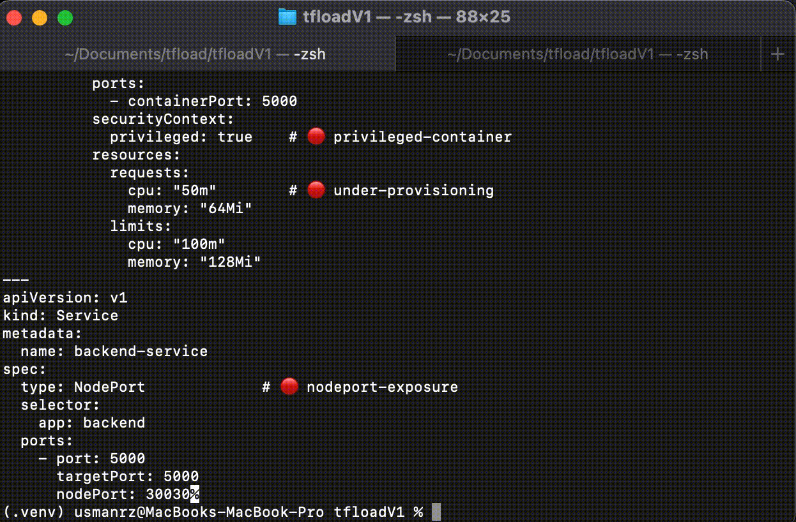

# KOSTRAL — Pre-Deployment Intelligence for Kubernetes

> Analyze • Optimize • Secure • Validate — before it hits your cluster

KOSTRAL helps developers and small teams catch configuration problems, identify resource waste, and spot security risks in Kubernetes manifests before deployment.

## 🎬 Demo

See KOSTRAL in action — analyzing a misconfigured Kubernetes manifest in seconds:



**Built by ClariOps** — bringing clarity to Kubernetes operations.

---


## 🚀 What is KOSTRAL?

KOSTRAL is a CLI-first engine that **analyzes and improves Kubernetes manifests before deployment**. 

It acts as a **pre-deployment intelligence layer**, helping teams detect issues, optimize resources, and enforce best practices.

Deployment is optional — KOSTRAL can run purely as an analysis engine or integrate into CI/CD pipelines.

👉 [See system model for how KOSTRAL works conceptually](docs/system-model.md)

---

## 📚 Documentation

KOSTRAL documentation is structured across multiple layers ([CLI Reference](./usage.md), architecture, system model, guarantees, vision).

👉 Start here: | [Documentation Index](docs/README.md)
       

---

## 🔥 Why KOSTRAL?

Unlike traditional tools that focus only on linting or validation:

- KOSTRAL combines validation, security, and optimization in a single run
- Provides actionable fixes (not just warnings)
- Focuses on pre-deployment intelligence, not post-failure debugging
- Designed for clarity and fast feedback, not complex pipelines

## ⚖️ Comparison

| Tool        | Validation | Security | Optimization | Auto Fix |
|------------|-----------|----------|-------------|---------|
| kube-score | ✅        | ❌       | ❌          | ❌      |
| trivy      | ❌        | ✅       | ❌          | ❌      |
| KOSTRAL        | ✅        | ✅       | ✅          | 🚧      |

## 🎯 The Problem

Kubernetes is powerful — but:

* ❌ Over-provisioned resources → wasted cloud cost
* ❌ Under-provisioned apps → instability under load
* ❌ Missing probes → unreliable deployments
* ❌ Security misconfigurations → critical risks
* ❌ Exposure misconfigurations → attack surface

Most tools detect problems **after deployment**.

👉 By then, it's already too late.

---

## 💡 The Solution

KOSTRAL shifts validation **left** — into the development phase.

It automatically:

* 🔍 Detects misconfigurations
* ⚙️ Optimizes resource allocation
* 🔐 Flags security risks
* 📊 Provides actionable fixes

Before anything reaches your cluster.

---

## ⚡ Key Capabilities

* 🧠 Intelligent resource optimization (CPU, memory, replicas)
* ⚠️ Validation engine (probes, exposure, scaling)
* 🔐 Security analysis (root user, privileged containers, image tags)
* 📦 Multi-resource support (Deployment, Service, PVC, ConfigMap, Secret, Ingress)
* 🎯 Actionable suggestions with impact + fixes
* 🧪 Dry-run mode for safe analysis

---

### 🔌 Modular Engine Design

KOSTRAL is built from independent engines that can be composed into workflows.

The default workflow is:

Optimizer → Validator → Security → Renderer

Engines own their responsibilities independently; the workflow determines how they are composed.

See `docs/system-model.md` and `docs/architecture.md` for the full model.

---

## 🔥 Quick Start

```bash
git clone <repo>
cd kostral
pip install -r requirements.txt
pip install -e .

### Analyze (Fastest)

koss explain ./examples/demo/bad.yaml

### Analyze + Optimize (Recommended)

koss optimize ./examples/demo/bad.yaml --dry-run

### Deploy (Optional)

koss optimize ./examples/demo/good.yaml --target=local
```

---
## 🧭 Command Guide

KOSTRAL provides different ways to use the same independent engines.

| Command | Workflow | Purpose |
| :--- | :--- | :--- |
| `koss explain` | `Validator → Security` | Analyze the input without running the Optimizer |
| `koss optimize` | `Optimizer → Validator → Security` | Optimize the deployment state, then analyze the resulting state |
| `koss remote` | User-defined workflow | Execute a workflow that can invoke engines through remote HTTP clients |
| `koss run` | User-defined workflow | Execute KOSTRAL DSL workflows *(currently on hold)* |
| `koss generate` | CLI-defined input | Create a Deployment from CLI parameters *(currently on hold)* |

### 🔌 Engine Composition

The engines are independent modules.

The workflow determines their order.

The default optimization workflow is:

```text
Optimizer → Validator → Security → Renderer
```

This does **not** mean the engines depend on one another internally.

For example, `Validator` can run without `Optimizer`:

```text
Validator → Security
```

while `optimize` uses the normal preparation workflow:

```text
Optimizer → Validator → Security
```

This allows KOSTRAL to remain plug-and-play while still providing predictable default workflows.

---

### 🌐 Remote Engine Composition

KOSTRAL includes an experimental remote composition example that demonstrates
how engines can run as separate processes and be invoked through HTTP.

The example uses:

- A remote Optimizer service
- A remote Validator service
- A remote Security service
- A local Renderer
- A workflow definition that determines their execution order

The remote clients exchange serialized IR, options, and report data with
the corresponding engine servers.

Run the example from the repository root after starting the three engine
servers:

```bash
koss remote ./examples/demo/bad.yaml \
  --exec ./examples/remote/workflow.py

```

This is a demonstration of remote engine invocation and workflow
composition. It does not currently provide dynamic service discovery,
automatic engine registration, engine uploads, or a production-ready
distributed execution platform.

See Remote Engine Composition for the setup,
execution flow, and current limitations.

see [remote-engines.md](./remote-engines.md)

---  

## 📊 Output Formats

KOSTRAL can produce results in different formats depending on the use case.

### CLI

Human-readable output for developers:

```bash
koss explain ./manifest.yaml
```

### JSON

Machine-readable output for CI/CD and automation:

```bash
koss explain ./manifest.yaml --output=json
```

### YAML

Manifest output for workflows that need the resulting Kubernetes configuration:

```bash
koss optimize ./manifest.yaml --output=yaml
```

These formats represent the same KOSTRAL processing results for different consumers:

```text
Developer       → CLI
CI/CD / Tools   → JSON
Kubernetes      → YAML
```
When using `--verbose`, the selected reporting mode controls how detailed information is presented. Keep the documentation aligned with the currently supported output modes rather than describing `--verbose` as a separate processing engine or workflow.
---

## 📊 Example Output 
👉 See: [Detailed Output](docs/transparency/output-example.md)

### CLI (Developer)
```bash
   koss explain ./examples/demo/bad.yaml 
```
Output:

```text

━━━━━━━━━━━━━━━━━━━━━━━━━━━━━━━━━━━━━━━━━━━━━━━━━━

📦 Resource: backend

⚠ LOW: under-provisioning

⚠ MEDIUM: no-readiness-probe

⚠ MEDIUM: no-liveness-probe

⚠ LOW: latest-tag

⚠ MEDIUM: run-as-root

━━━━━━━━━━━━━━━━━━━━━━━━━━━━━━━━━━━━━━━━━━━━━━━━━━

📦 Resource: backend-service

⚠ MEDIUM: nodeport-exposure

━━━━━━━━━━━━━━━━━━━━━━━━━━━━━━━━━━━━━━━━━━━━━━━━━━

📊 Summary
Errors: 0	Warnings: 6	Optimizations: 0

✔ Status: PASSED

```
---

### JSON (CI/CD / Tools)
```bash
   koss explain ./examples/demo/bad.yaml --output=json 
```
Output:

```json
{
  "status": "PASSED",
  "summary": {
    "errors": 0,
    "warnings": 6,
    "optimizations": 0
  },
  "resources": {
    "backend": {
      "errors": [],
      "warnings": [
        {
          "rule": "under-provisioning",
          "severity": "low",
          "category": "reliability"
        },
        {
          "rule": "no-readiness-probe",
          "severity": "medium",
          "category": "reliability"
        },
        {
          "rule": "no-liveness-probe",
          "severity": "medium",
          "category": "reliability"
        },
        {
          "rule": "latest-tag",
          "severity": "low",
          "category": "generic"
        },
        {
          "rule": "run-as-root",
          "severity": "medium",
          "category": "security"
        }
      ],
      "optimizations": []
    },
    "backend-service": {
      "errors": [],
      "warnings": [
        {
          "rule": "nodeport-exposure",
          "severity": "medium",
          "category": "network"
        }
      ],
      "optimizations": []
    }
  }
}
```

### YAML (Kubernetes)
```bash
   koss explain ./examples/demo/bad.yaml --output=yaml 
```

Output: 

```yaml
apiVersion: apps/v1
kind: Deployment
metadata:
  name: backend
  labels:
    app: backend
spec:
  replicas: 1
  selector:
    matchLabels:
      app: backend
  template:
    metadata:
      labels:
        app: backend
    spec:
      containers:
      - name: backend
        image: nginx:latest
        ports:
        - containerPort: 5000
        resources:
          requests:
            cpu: 50m
            memory: 64Mi
          limits:
            cpu: 100m
            memory: 128Mi
---
apiVersion: v1
kind: Service
metadata:
  name: backend-service
spec:
  type: NodePort
  selector:
    app: backend
  ports:
  - port: 5000
    protocol: TCP
    targetPort: 5000
    nodePort: 30030

```
---
## 🧪 Example Manifests

```bash
examples/demo/bad.yaml   # intentionally misconfigured
examples/demo/good.yaml  # optimized version
```

Run:

```bash
koss optimize ./examples/demo/bad.yaml --dry-run
```
Run with Deployment(Optional):
```bash
koss optimize ./examples/demo/bad.yaml --target=local
```


---
## 🔄 CI/CD Integration

KOSTRAL is designed to run in pipelines.

Example using GitHub Actions:

```yaml
- name: Run KOSTRAL
  run: |
    koss optimize ./k8s.yaml --dry-run --output=json > report.json

- name: Fail if issues found
  run: |
    cat report.json | jq -r '.status' | grep FAILED && exit 1 || exit 0
```

---

## 📦 Helm Support

KOSTRAL does not directly parse Helm charts.

Instead, it works with **rendered Kubernetes manifests**, enabling seamless integration with Helm workflows.

```bash 
helm create mychart
helm template ./examples/helmCharts/mychart | koss optimize - --dry-run 
```

This approach:

* avoids re-implementing Helm
* works with any chart
* keeps KOSTRAL lightweight and fast

Native Helm support is planned in future releases.

---

## 🏗 How It Works

KOSTRAL follows a pipeline-based architecture:

1. Load manifests → convert into IR (Intermediate Representation)
2. Run engines in order:

   * Optimizer (applies safe improvements)
   * Validator (detects misconfigurations)
   * Security (detects risks)

3. Render final manifests from IR
4. (Optional) Deploy to cluster

👉 See full architecture:
docs/architecture.md


---

## 🧠 Core Philosophy

> Fix problems before they reach the cluster.

---

## 👥 Who is this for?

* DevOps Engineers
* Backend developers deploying to Kubernetes
* Startups optimizing cloud cost
* Teams enforcing deployment best practices

---

## ⚠️ Current Status

* CLI: ✅ Stable
* Engines: ✅ Functional
* Multi-resource support: ✅
* Cloud deployment: 

⚠️ The Cloud Engine is currently an experimental deployment implementation.

It exists to demonstrate and test the execution path from prepared
output to a Kubernetes target.

It is not part of the core preparation-engine contract and should not
be treated as the architectural model for future engines.

In particular, the current implementation contains target-specific
deployment behavior that is intentionally not representative of the
core KOSTRAL engine model.

The architectural model requires engine responsibilities and mutations
to be explicit and composable. Environment-specific preparation or
mutation should eventually be handled by a dedicated, explicitly
defined engine/adapter before execution.

---

## 🗺 Roadmap

* Auto-fix engine for safe automated remediation
* Cloud-specific adaptation layer (AKS, GKE, EKS)
* Relationship-aware analysis (cross-resource intelligence)
* Rule expansion (cost + reliability)
* AI-powered suggestions
* SaaS platform (hosted analysis)
* Multi-orchestrator support

---

Experimental DSL support is under development and will be introduced in future releases.

## 🤝 Contributing

Contributions are welcome!

Please see [CONTRIBUTING.md](CONTRIBUTING.md) for guidelines, rules, and architecture details.

We are currently stabilizing the core system, so we recommend reviewing the contribution rules before submitting changes.


## 📜 License

© 2026 ClariOps. Licensed under the Apache License 2.0 — see [LICENSE](LICENSE) for details.

##

---

## 🧩 About ClariOps

ClariOps builds developer-first tools focused on clarity, reliability, and intelligence in Kubernetes and DevOps.

KOSTRAL is the first step toward a broader platform for pre-deployment intelligence.
